<div align="center">


# ircnext

**Un client IRC moderne, rapide et sûr, écrit en Rust.**<br>
L'ergonomie éprouvée de HexChat, les normes IRCv3 et une interface native soignée.

[English](README.md) · **Français**

[](https://github.com/BrystoQ/ircnext/actions/workflows/ci.yml)
[](https://github.com/BrystoQ/ircnext/releases/latest)
[](LICENSE)
[](https://www.rust-lang.org)
[](#ircv3)


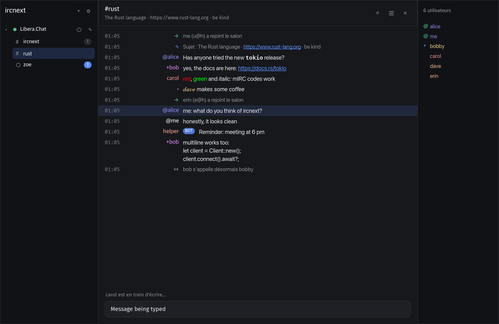

</div>

---

## Sommaire

- [Pourquoi ircnext](#pourquoi-ircnext)
- [Fonctionnalités](#fonctionnalités)
- [Captures d'écran](#captures-décran)
- [Installation](#installation)
- [Prise en main](#prise-en-main)
- [Raccourcis clavier](#raccourcis-clavier)
- [Commandes](#commandes)
- [IRCv3](#ircv3)
- [Scripts](#scripts)
- [Configuration](#configuration)
- [Sécurité](#sécurité)
- [Architecture](#architecture)
- [Développement](#développement)
- [Feuille de route](#feuille-de-route)
- [Contribuer](#contribuer)
- [Licence](#licence)

## Pourquoi ircnext

- **Natif et léger** : pas de navigateur embarqué. L'interface est dessinée par le GPU avec [iced](https://iced.rs), dans un seul exécutable d'environ 14 Mo.
- **Familier** : arbre réseaux → salons, liste des membres, pseudos colorés alignés, complétion par Tab… tout ce qui fait l'efficacité de HexChat.
- **Moderne** : historique côté serveur, indicateur de saisie, messages lus synchronisés, suppression de messages, recherche rapide d'onglet, suggestions pendant la frappe.
- **Sûr par conception** : aucun `unsafe`, aucun mot de passe en clair sur le réseau, mots de passe dans le trousseau du système, liens filtrés, protections anti-flood. Voir [Sécurité](#sécurité).
- **Entièrement personnalisable** : 7 thèmes, raccourcis reconfigurables, notifications, confidentialité, journaux… tout se règle depuis l'interface, en français ou en anglais.

## Fonctionnalités

<table>
<tr><td width="50%" valign="top">

**Discussion**
- Plusieurs réseaux en parallèle, reconnexion automatique
- Proxy SOCKS5 par réseau (Tor, tunnel SSH), nom résolu par le proxy
- TLS par défaut, SASL PLAIN et EXTERNAL (certificat client, CertFP), STS
- Codes de mise en forme mIRC (gras, couleurs…)
- Liens cliquables, mentions mises en évidence
- Messages privés, notices, actions `/me`, CTCP
- Historique chargé à l'arrivée (IRCv3 `chathistory`)
- Recherche dans l'historique d'un onglet
- Journaux sur disque, utilisateurs ignorés
- Transferts de fichiers DCC : envoi et réception, reprise, mode passif, glisser-déposer
- Chiffrement FiSH (compatible FiSH 10) : ECB et CBC, échange de clés DH1080

</td><td width="50%" valign="top">

**Confort**
- Suggestions pendant la frappe : commandes, salons, pseudos, commandes NickServ/ChanServ et commandes de bots `!…`
- Complétion par Tab façon HexChat (`pseudo: `)
- Recherche rapide d'onglet (`⌘T` / `Ctrl+T`)
- 38 raccourcis reconfigurables, adaptés à macOS et Windows
- Notifications du système, rebond du Dock, compteur dans le titre
- Commandes exécutées après la connexion, pseudos de secours

</td></tr>
<tr><td valign="top">

**Apparence**
- 7 thèmes : Graphite, Minuit, Noir absolu (OLED), Nordique, Moka, Clair, Sépia, ou automatique selon le système
- Couleur d'accent libre
- Taille du texte, police à chasse fixe, mode compact
- Colonne des pseudos réglable
- Interface en français ou en anglais, selon la langue du système par défaut

</td><td valign="top">

**Confidentialité**
- Indicateur de saisie et accusés de lecture désactivables
- Réponses CTCP désactivables, VERSION personnalisable, TIME en UTC
- Mots de passe NickServ masqués partout
- Contenu des notifications masquable

</td></tr>
</table>

## Captures d'écran

| Thème Clair | Thème Sépia |
|:---:|:---:|
| 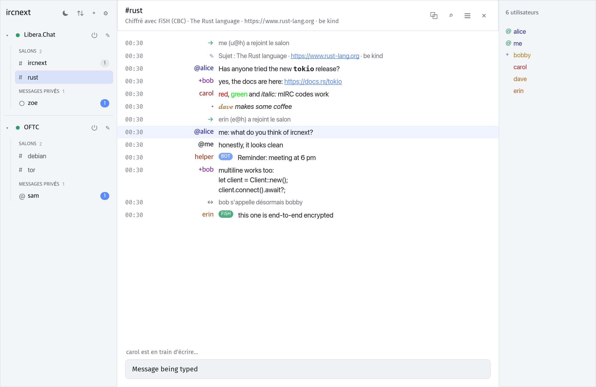 | 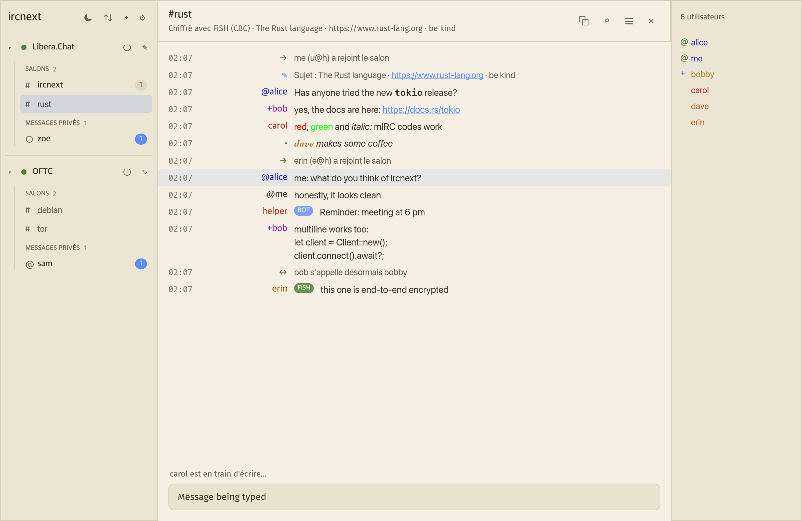 |
| **Suggestions pendant la frappe** | **Recherche rapide d'onglet** |
| 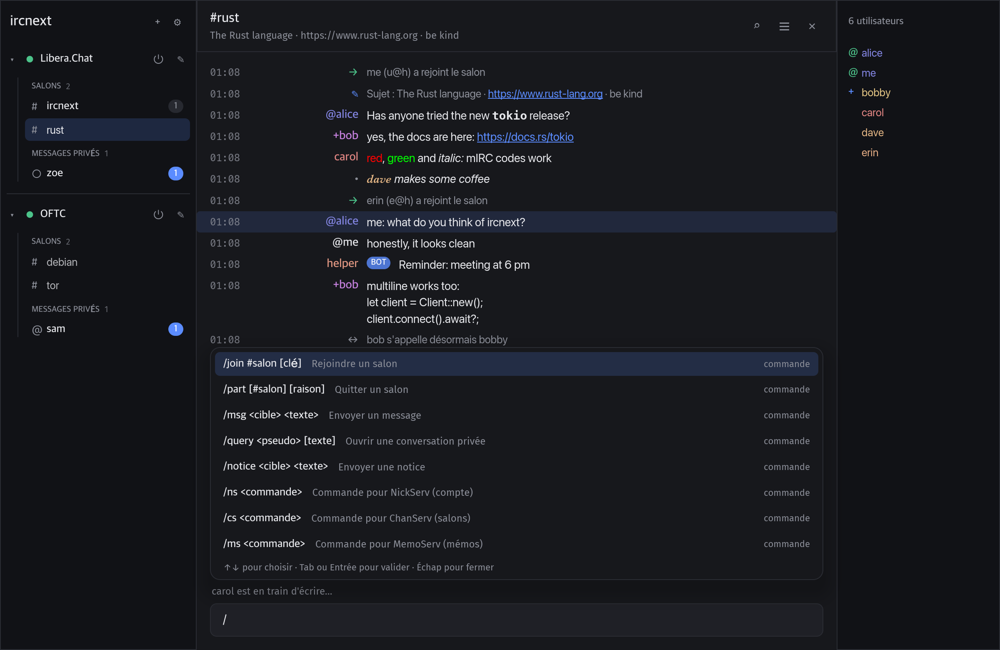 | 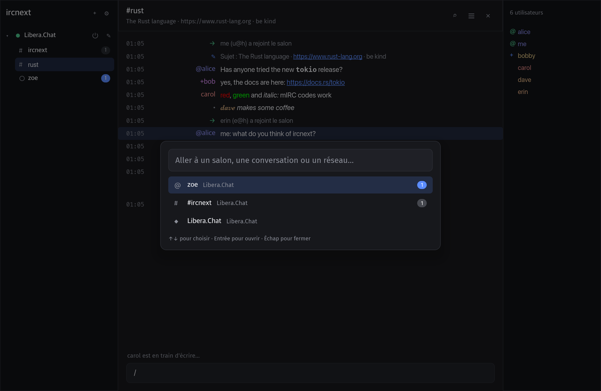 |
| **Réglages** | **Raccourcis configurables** |
| 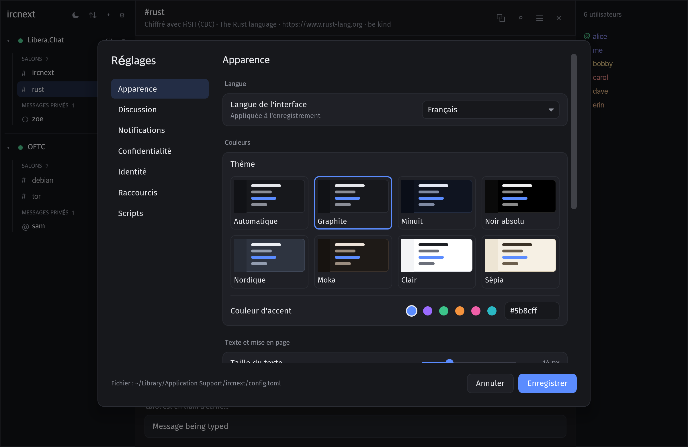 | 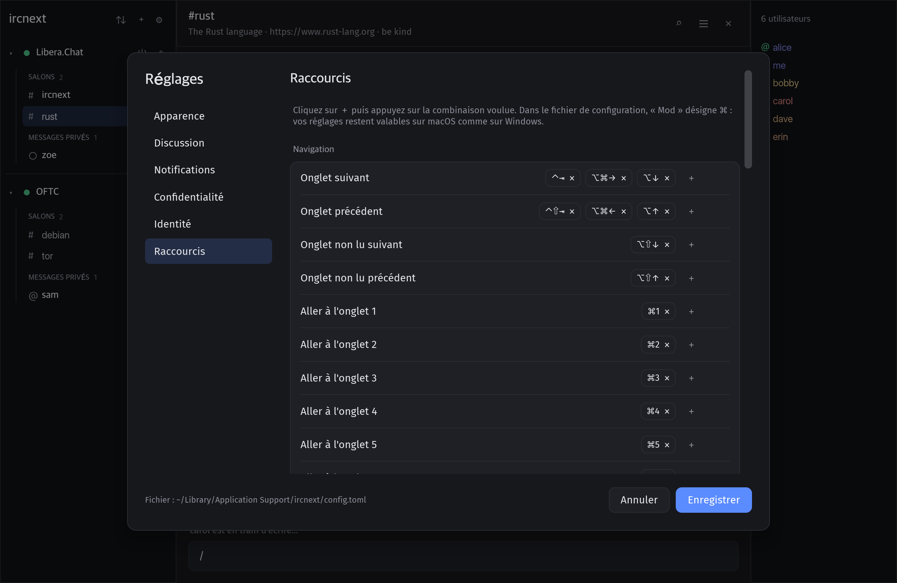 |

<details>
<summary>Plus de captures</summary>

| Thème Minuit | Thème Nordique |
|:---:|:---:|
| 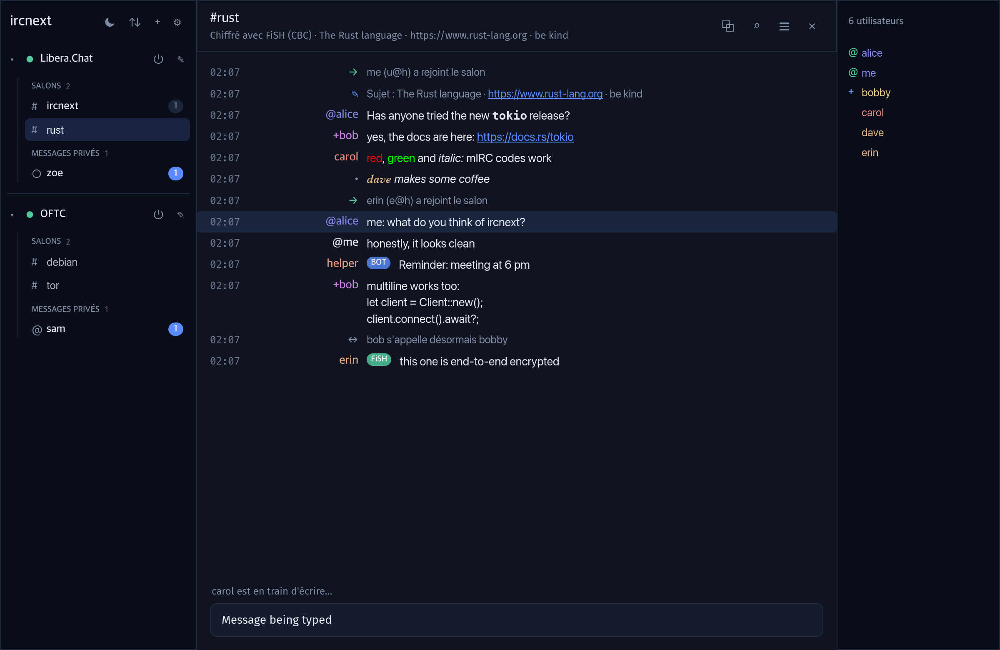 | 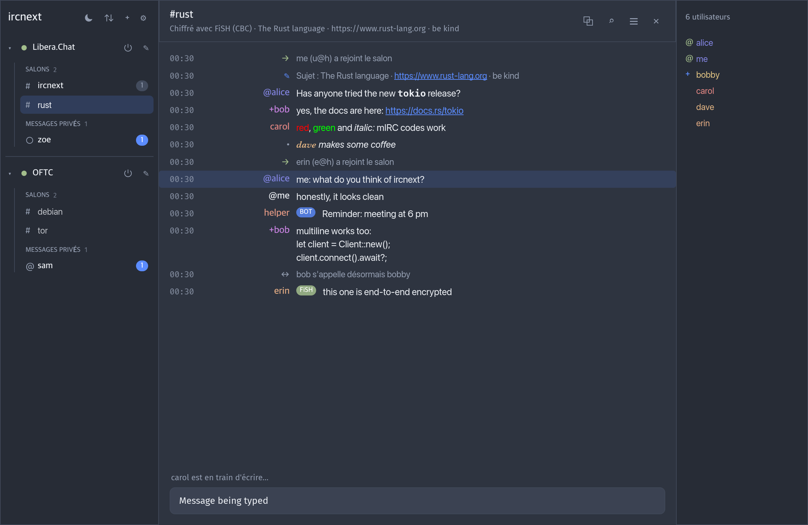 |
| **Recherche dans l'onglet** | **Ajout d'un réseau** |
| 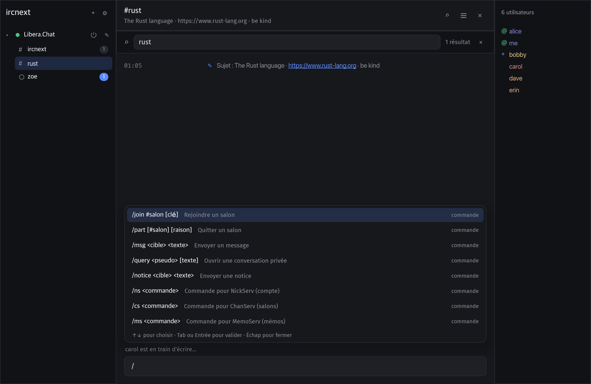 | 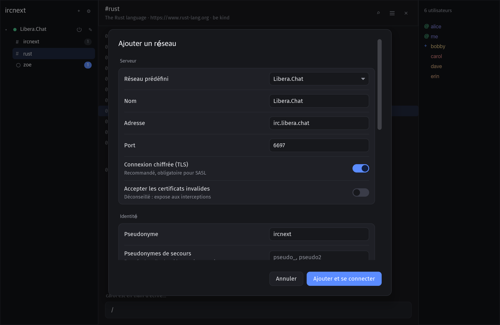 |
| **Transferts de fichiers** | |
| 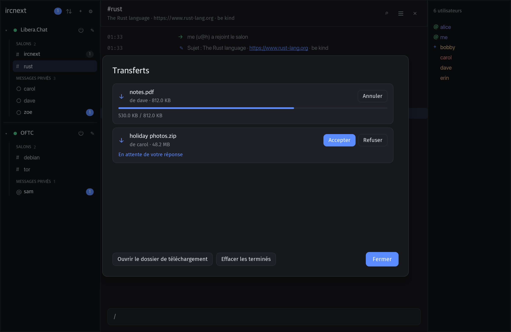 | |

</details>

## Installation

### Télécharger

Chaque version publie des exécutables prêts à l'emploi sur la [page des releases](https://github.com/BrystoQ/ircnext/releases/latest) :

| Système | Fichier |
|---|---|
| macOS 11+ (Apple Silicon et Intel) | `ircnext-X.Y.Z-macos.zip` |
| Windows 10+ (x64) | `ircnext-X.Y.Z-windows-x64.zip` |
| Linux (x64) | `ircnext-X.Y.Z-linux-x64.tar.gz` |

Les sommes de contrôle sont dans `SHA256SUMS.txt`. Les nouveautés de chaque version sont décrites dans les [notes de version](CHANGELOG.fr.md).

> [!IMPORTANT]
> Les exécutables ne sont pas encore signés par un certificat Apple ou Microsoft. Au premier lancement :
> - **macOS** : clic droit sur `ircnext.app` puis **Ouvrir**, ou `xattr -dr com.apple.quarantine ircnext.app` ;
> - **Windows** : SmartScreen affiche un avertissement, cliquez sur **Informations complémentaires** puis **Exécuter quand même**.

### Compiler depuis les sources

ircnext se compile avec [Rust](https://rustup.rs) 1.90 ou plus récent.

```sh
git clone https://github.com/BrystoQ/ircnext.git
cd ircnext
cargo build --release
./target/release/ircnext
```

Sous Windows, l'exécutable est `target\release\ircnext.exe`.

<details>
<summary>Dépendances système sous Linux</summary>

```sh
# Debian / Ubuntu
sudo apt install build-essential pkg-config libxkbcommon-dev libwayland-dev
```

</details>

> [!NOTE]
> ircnext est développé et testé sur macOS ; Windows et Linux sont pris en charge et compilés par l'intégration continue.

## Prise en main

1. Au premier lancement, choisissez un réseau dans la liste (Libera.Chat, OFTC, Rizon, EFnet, hackint, IRCnet, QuakeNet, Undernet, Ergo) ou saisissez-en un.
2. Indiquez votre pseudonyme et, si vous avez un compte, choisissez une **identification** (mot de passe ou certificat client).
3. Rejoignez un salon avec `/join #salon`, ou listez-le dans **Salons à rejoindre** pour le retrouver à chaque connexion.

Tapez `/` pour découvrir les commandes, `@` pour mentionner quelqu'un, `#` pour un salon. `⌘,` (`Ctrl+,` sous Windows et Linux) ouvre les réglages, où **Apparence → Langue** passe du français à l'anglais.

## Raccourcis clavier

Tous les raccourcis se modifient dans **Réglages → Raccourcis**. `Mod` désigne `⌘` sur macOS et `Ctrl` ailleurs : un même réglage vaut pour les deux systèmes.

| Action | macOS | Windows / Linux |
|---|---|---|
| Onglet suivant / précédent | `⌃⇥` `⌥⌘→` `⌥↓` / `⌃⇧⇥` `⌥⌘←` `⌥↑` | `Ctrl+Tab` `Ctrl+Page↓` `Alt+↓` / `Ctrl+Maj+Tab` `Ctrl+Page↑` `Alt+↑` |
| Onglet non lu suivant / précédent | `⌥⇧↓` / `⌥⇧↑` | `Alt+Maj+↓` `Alt+A` / `Alt+Maj+↑` |
| Onglet 1 à 8, dernier onglet | `⌘1`…`⌘8`, `⌘9` | `Alt+1`…`Alt+8`, `Alt+9` |
| Recherche rapide d'onglet | `⌘T` `⌘J` | `Ctrl+T` `Ctrl+J` |
| Rechercher dans l'onglet | `⌘F` | `Ctrl+F` |
| Fermer l'onglet / tout marquer comme lu | `⌘W` / `⇧⎋` | `Ctrl+W` `Ctrl+F4` / `Maj+Échap` |
| Page précédente / suivante | `⇞` / `⇟` | `Page↑` / `Page↓` |
| Début / fin de l'historique | `⌘↑` `⌘↖` / `⌘↓` `⌘↘` | `Ctrl+Début` / `Ctrl+Fin` |
| Membres / barre latérale | `⌘⇧U` / `⌘⇧S` | `Ctrl+Maj+U` / `Ctrl+Maj+S` |
| Effacer l'onglet | `⌘L` | `Ctrl+L` |
| Zoom +, −, normal | `⌘=` `⌘-` `⌘0` | `Ctrl+=` `Ctrl+-` `Ctrl+0` |
| Gras, italique, souligné, barré | `⌘B` `⌘I` `⌘U` `⌘⇧X` | `Ctrl+B` `Ctrl+I` `Ctrl+U` `Ctrl+Maj+X` |
| Couleur, inversion, sans mise en forme | `⌘K` `⌘R` `⌘O` | `Ctrl+K` `Ctrl+R` `Ctrl+O` |
| Ajouter un réseau / réglages / quitter | `⌘N` / `⌘,` / `⌘Q` | `Ctrl+N` / `Ctrl+,` `Ctrl+P` / `Ctrl+Q` |
| Ne pas déranger | `⌘⇧D` | `Ctrl+Maj+D` |

Touches fixes : `Tab` complète, `↑` / `↓` parcourent l'historique de saisie ou les suggestions, `Entrée` envoie, `Échap` ferme.

## Commandes

`/help` affiche la liste complète dans l'application.

| Commande | Rôle |
|---|---|
| `/join #salon [clé]`, `/part [#salon] [raison]` | Rejoindre ou quitter un salon |
| `/msg <cible> <texte>`, `/query <pseudo>`, `/notice` | Messages et conversations privées |
| `/me <action>` | Décrire une action |
| `/nick`, `/away [message]`, `/back` | Pseudonyme et absence |
| `/topic [sujet]`, `/whois <pseudo>`, `/invite` | Salon et utilisateurs |
| `/kick`, `/ban`, `/unban`, `/op`, `/deop`, `/voice`, `/devoice`, `/mode` | Modération |
| `/ns`, `/cs`, `/ms`, `/hs` | NickServ, ChanServ, MemoServ, HostServ |
| `/ignore [masque]`, `/unignore <masque>` | Utilisateurs ignorés |
| `/ctcp`, `/quote <ligne>` | CTCP et commande brute |
| `/connect`, `/quit [raison]`, `/close`, `/clear` | Connexion et onglets |
| `/dcc send <pseudo> <fichier>`, `/dcc` | Envoyer un fichier, afficher les transferts |
| `/setkey [cible] <clé>`, `/delkey`, `/keyx [pseudo]` | Chiffrement FiSH : définir ou retirer une clé, en échanger une (DH1080) |

Les commandes de NickServ, ChanServ, MemoServ et HostServ sont suggérées avec leur syntaxe dès `/ns `. Les commandes de bots (`!meteo`, `!help`…) vues dans un salon sont proposées dès `!`.

## IRCv3

ircnext négocie automatiquement les extensions [IRCv3](https://ircv3.net) proposées par le serveur.

| Domaine | Extensions |
|---|---|
| Connexion | `cap-notify`, `sasl` (PLAIN, EXTERNAL), `sts` |
| Messages | `message-tags`, `server-time`, `echo-message`, `batch`, `labeled-response`, `msgid` (dédoublonnage), `standard-replies`, `draft/multiline`, `UTF8ONLY` |
| Historique | `draft/chathistory`, `draft/event-playback`, `draft/read-marker`, `draft/message-redaction` |
| Utilisateurs | `account-notify`, `account-tag`, `away-notify`, `extended-join`, `chghost`, `setname`, `multi-prefix`, `userhost-in-names`, `invite-notify` |
| Présence | `MONITOR`, `extended-monitor`, `WHOX`, `BOT` |
| Salons | `draft/channel-rename` |
| Tags clients | `+typing`, brouillon [`+draft/autocomplete`](https://github.com/ircv3/ircv3-specifications/pull/415) (complétion proposée par les bots) |

## Scripts

ircnext exécute les scripts mIRC (mSL). Placez des fichiers `.mrc` dans le dossier `scripts` à côté du fichier de configuration, puis tapez `/reload` ; ils sont aussi chargés au démarrage. Un exemple commenté se trouve dans [`docs/scripts/example.mrc`](docs/scripts/example.mrc).

```mrc
alias hello {
  if ($1 == $null) { echo -a Usage: /hello <nick> | halt }
  msg $chan Hello $1 $+ , welcome to $chan $+ !
}
```

Déjà pris en charge :

- `alias` (et `alias -l`), appelés comme commandes (`/hello bob`) ou comme identifiants (`$initials(…)`), avec `return` ;
- `if` / `elseif` / `else`, `while`, `break`, `continue`, `halt` ; séparateur `|` et blocs `{ }` ; commentaires `;` et `/* */` ;
- variables : `var` (locales), `set` / `unset` / `inc` / `dec` (globales) ; `$1`, `$2-`, `$0` ; `$+` ;
- conditions : `==`, `===`, `!=`, `<`, `>`, `<=`, `>=`, `//`, `\\`, `&`, `isin`, `iswm`, `isnum`, `isletter`, `isalpha`, `isalnum`, `islower`, `isupper`, `ison`, `isop`, `isvoice`, `isreg`, `ischan`, avec `!`, `&&`, `||` ;
- identifiants : `$me`, `$chan`, `$active`, `$network`, `$server`, `$time`, `$date`, `$ctime`, `$len`, `$upper`, `$lower`, `$left`, `$right`, `$mid`, `$replace`, `$remove`, `$pos`, `$count`, `$str`, `$strip`, `$chr`, `$asc`, `$gettok`, `$numtok`, `$addtok`, `$deltok`, `$istok`, `$findtok`, `$puttok`, `$instok`, `$calc`, `$round`, `$int`, `$abs`, `$rand`, `$iif`, `$ord`… ;
- toutes les commandes d'ircnext (`msg`, `notice`, `join`, `mode`, `echo`…) ;
- événements : `on TEXT`, `ACTION`, `NOTICE`, `JOIN`, `PART`, `KICK`, `QUIT`, `NICK`, `TOPIC`, `INVITE`, `OP`, `DEOP`, `VOICE`, `DEVOICE`, `CONNECT`, `DISCONNECT`, `START` et `INPUT` (`halt` empêche l'envoi du texte), avec textes filtrés (`*`, `?`, `&` pour un mot), cibles (`#`, `?`, `*`, `#a,#b`), préfixes `me:`, `!` et `@`, et `$nick`, `$address`, `$chan`, `$target`, `$knick`, `$newnick`, `$opnick`, `$vnick`.

```mrc
on *:TEXT:!seen &:#:msg $chan $nick $+ : I have not seen $2 yet.
on *:JOIN:#:notice $nick Welcome to $chan $+ !
```

- minuteries : `/timer[nom] [-m] <répétitions> <intervalle> <commande>` (`0` répétition : sans fin), `/timers`, `/timer<nom> off`, `/timers off` ;
- tables de hachage : `hmake`, `hadd`, `hinc`, `hdec`, `hdel [-w]`, `hfree`, `hsave`, `hload`, `$hget(table, élément)`, `$hget(table, N).item` / `.data` ;
- fichiers : `$readini`, `/writeini`, `/remini`, `$read(fichier, [N])`, `$lines`, `$isfile`, `/write [-c]`. Les scripts ne lisent et n'écrivent que des fichiers du dossier `scripts` ;
- variables globales conservées d'une session à l'autre (`scripts/vars.ini`).

Un gestionnaire de scripts arrive ensuite. Un script qui boucle sans fin est arrêté automatiquement.

## Configuration

Tout se règle depuis l'interface. Les réglages sont enregistrés dans un fichier TOML :

| Système | Emplacement |
|---|---|
| macOS | `~/Library/Application Support/ircnext/config.toml` |
| Windows | `%APPDATA%\ircnext\config\config.toml` |
| Linux | `~/.config/ircnext/config.toml` |

La variable d'environnement `IRCNEXT_CONFIG` permet d'utiliser un autre fichier. Les journaux sont rangés dans un dossier `logs/` et les certificats clients créés dans un dossier `certs/`, tous deux à côté de la configuration.

## Sécurité

- **Aucun mot de passe en clair** : SASL est refusé sans TLS, sauf vers un serveur local (bouncer).
- **Mots de passe dans le trousseau du système** (Trousseau d'accès, Gestionnaire d'identifiants Windows, Secret Service), jamais dans le fichier de configuration.
- **Certificats clients** : SASL EXTERNAL et CertFP, avec des certificats auto-signés créés par l'application (`0600`).
- **STS** n'est mémorisé qu'après une connexion TLS au certificat vérifié.
- **Fichiers privés** : configuration et journaux en `0600`, dossiers en `0700`, écriture atomique.
- **Mots de passe NickServ masqués** à l'affichage, dans les journaux et l'historique de saisie.
- **Liens filtrés** : seuls `http` et `https` s'ouvrent ; les caractères de contrôle bidirectionnels sont retirés, un lien ne peut donc pas être maquillé.
- **FiSH** : clés rangées dans le trousseau du système ; clés publiques DH1080 vérifiées (RFC 2631) contre les attaques par petit sous-groupe ; messages chiffrés signalés, et l'en-tête indique quand une conversation est chiffrée. FiSH protège le contenu vis-à-vis des serveurs, pas le fait de savoir qui parle à qui.
- **DCC** : une proposition n'est jamais acceptée automatiquement ; le nom du fichier est débarrassé de tout chemin et la taille annoncée est respectée.
- **Anti-flood** : envoi limité (5 messages, puis 1 toutes les 2 s), réponses CTCP limitées.
- **Robustesse** : mémoire bornée face à un serveur hostile, aucune injection de commande possible, `unsafe` interdit dans tout le code.

Pour signaler une vulnérabilité, voir [SECURITY.md](SECURITY.md).

## Architecture

Un espace de travail Cargo en quatre crates, du protocole à l'interface :

```
crates/
├── proto/    ircnext-proto   Protocole IRC pur, sans I/O : messages, tags IRCv3,
│                             mise en forme mIRC, ISUPPORT, casemapping
├── client/   ircnext-client  Connexion TCP/TLS (rustls), enregistrement CAP/SASL/STS,
│                             état du réseau, reconnexion, limitation du débit
├── script/   ircnext-script  Interpréteur de scripts mIRC (mSL), sans I/O : analyse,
│                             évaluation, conditions, identifiants intégrés
└── app/      ircnext         Interface iced (architecture Elm) : onglets, réglages,
                              raccourcis, notifications, journaux, traductions
```

La logique protocolaire est écrite sans entrées/sorties et testée isolément ; seules quelques fonctions touchent au réseau. Le code et ses commentaires sont en anglais ; les textes de l'interface sont traduits dans [`crates/app/locales/fr.toml`](crates/app/locales/fr.toml).

## Développement

```sh
cargo test --workspace                          # ~190 tests
cargo clippy --workspace --all-targets          # clippy::pedantic, zéro avertissement
cargo test -p ircnext -- --ignored snapshots    # captures dans target/snapshots/{en,fr}/
```

Les captures de ce README sont générées par le test `snapshots`, sans fenêtre, puis copiées dans `docs/screenshots/`.

## Feuille de route

- [x] Binaires prêts à l'emploi (macOS, Windows, Linux)
- [x] Mots de passe dans le trousseau du système
- [x] Authentification par certificat (SASL EXTERNAL)
- [x] Interface en anglais, traduction française
- [x] Proxy SOCKS5
- [x] Transferts DCC
- [x] Chiffrement FiSH 10 natif (Blowfish, échange de clés DH1080)
- [x] Scripts compatibles mIRC (mSL) : alias et langage
- [x] Événements de scripts (`on TEXT`, `on JOIN`…)
- [x] Minuteries, tables de hachage, fichiers ini et texte
- [ ] Gestionnaire de scripts
- [x] `draft/multiline`

## Contribuer

Les contributions sont les bienvenues ! Lisez [CONTRIBUTING.md](CONTRIBUTING.md) avant d'ouvrir une *pull request*.

## Licence

Distribué sous licence [MIT](LICENSE). © 2026 BrystoQ.
