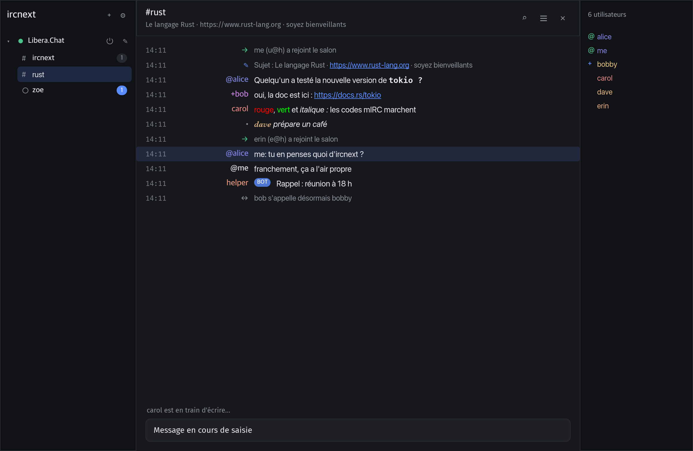
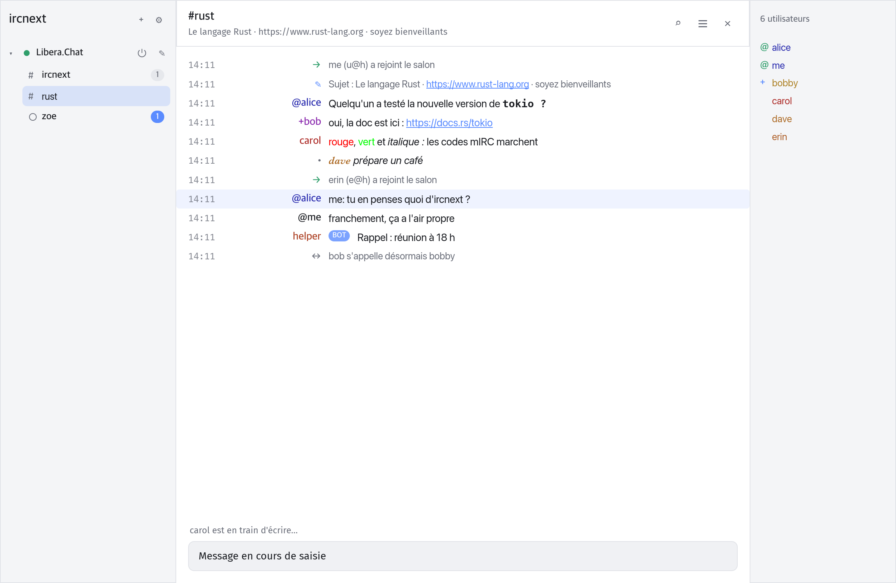
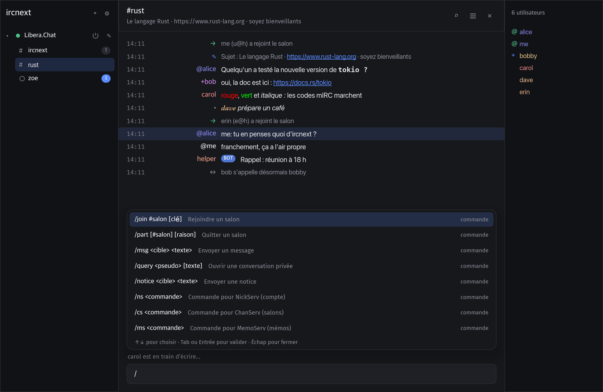
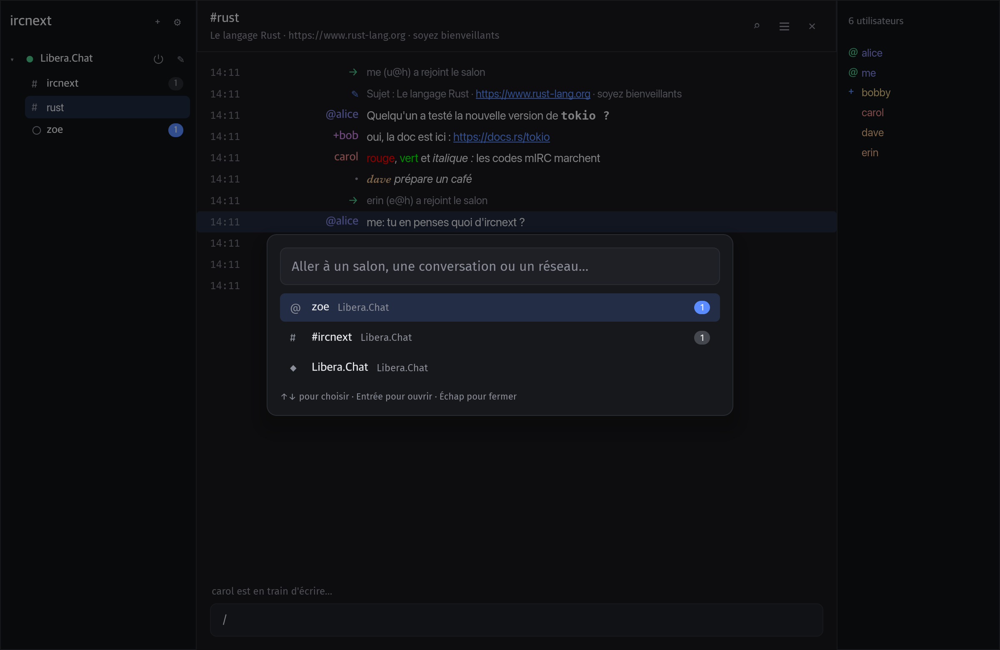
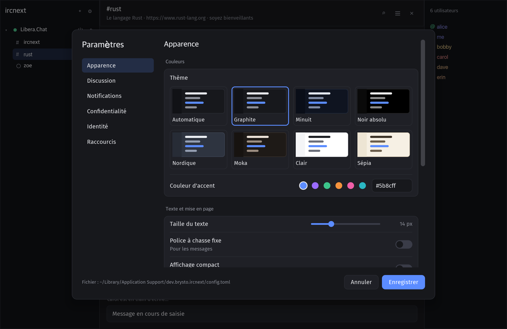
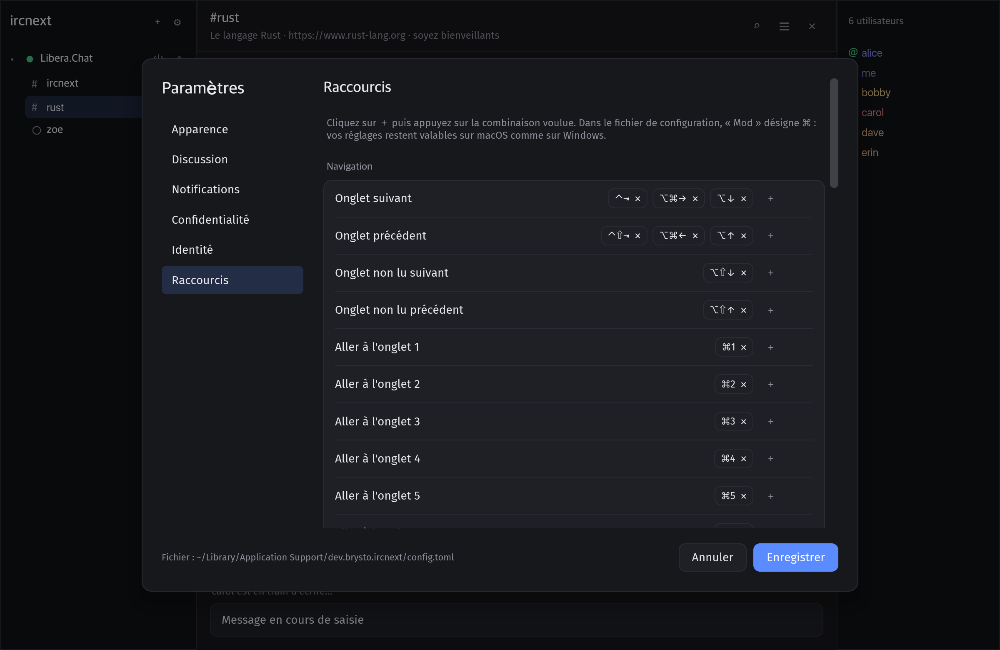
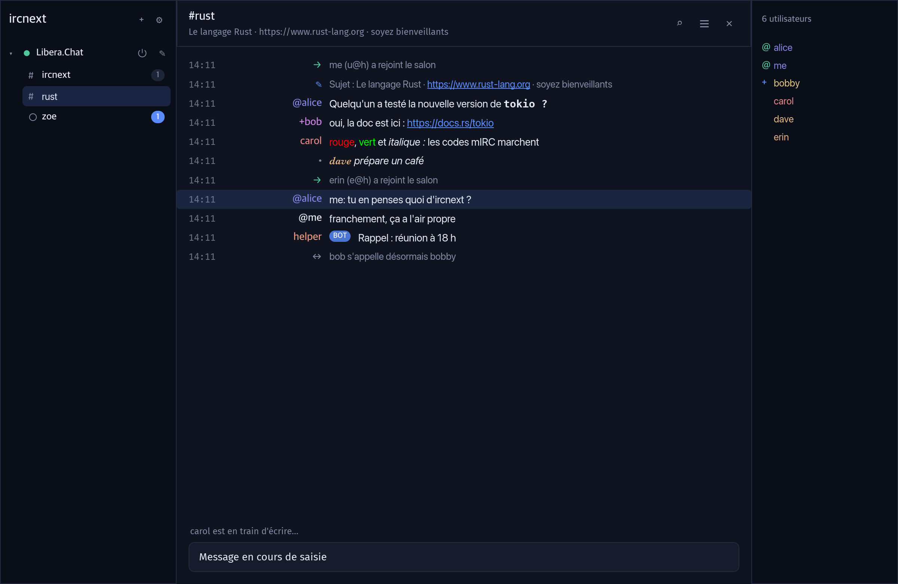
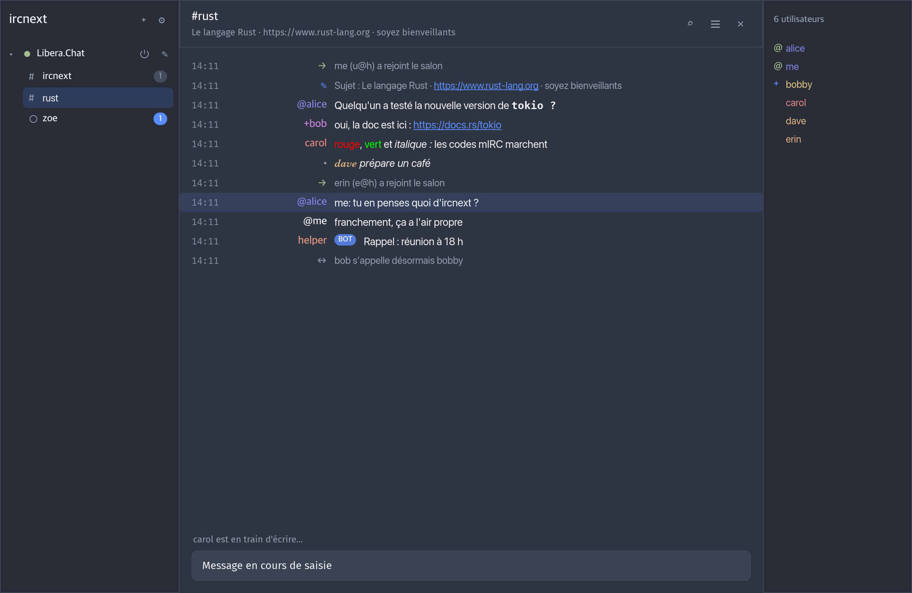
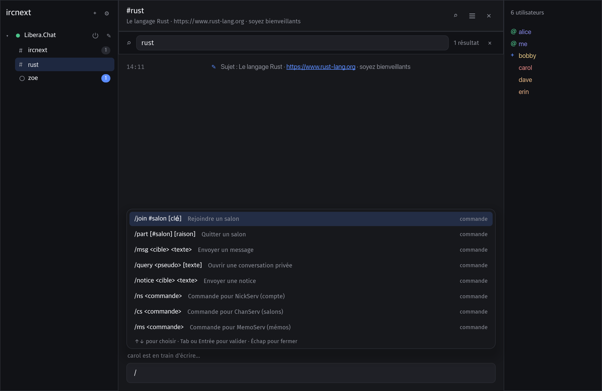
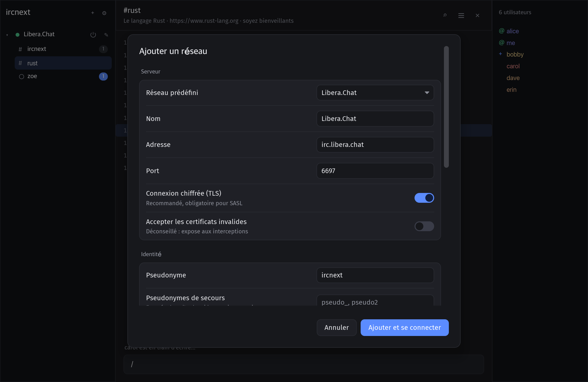

<div align="center">

# ircnext

**Un client IRC moderne, rapide et sûr, écrit en Rust.**<br>
L'ergonomie éprouvée de HexChat, les normes IRCv3 et une interface native soignée.

[](https://github.com/BrystoQ/ircnext/actions/workflows/ci.yml)
[](LICENSE)
[](https://www.rust-lang.org)
[](#ircv3)




</div>

---

## Sommaire

- [Pourquoi ircnext](#pourquoi-ircnext)
- [Fonctionnalités](#fonctionnalités)
- [Captures d'écran](#captures-décran)
- [Installation](#installation)
- [Prise en main](#prise-en-main)
- [Raccourcis clavier](#raccourcis-clavier)
- [Commandes](#commandes)
- [IRCv3](#ircv3)
- [Configuration](#configuration)
- [Sécurité](#sécurité)
- [Architecture](#architecture)
- [Développement](#développement)
- [Feuille de route](#feuille-de-route)
- [Contribuer](#contribuer)
- [Licence](#licence)

## Pourquoi ircnext

- **Natif et léger** : pas de navigateur embarqué. L'interface est dessinée par le GPU avec [iced](https://iced.rs), dans un seul exécutable d'environ 14 Mo.
- **Familier** : arbre réseaux → salons, liste des membres, pseudos colorés alignés, complétion par Tab… tout ce qui fait l'efficacité de HexChat.
- **Moderne** : historique côté serveur, indicateur de saisie, messages lus synchronisés, suppression de messages, recherche rapide d'onglet, suggestions pendant la frappe.
- **Sûr par conception** : aucun `unsafe`, aucun mot de passe en clair sur le réseau, liens filtrés, protections anti-flood. Voir [Sécurité](#sécurité).
- **Entièrement personnalisable** : 7 thèmes, raccourcis reconfigurables, notifications, confidentialité, journaux… tout se règle depuis l'interface.

## Fonctionnalités

<table>
<tr><td width="50%" valign="top">

**Discussion**
- Plusieurs réseaux en parallèle, reconnexion automatique
- TLS par défaut, SASL PLAIN, STS
- Codes de mise en forme mIRC (gras, couleurs…)
- Liens cliquables, mentions mises en évidence
- Messages privés, notices, actions `/me`, CTCP
- Historique chargé à l'arrivée (IRCv3 `chathistory`)
- Recherche dans l'historique d'un onglet
- Journaux sur disque, utilisateurs ignorés

</td><td width="50%" valign="top">

**Confort**
- Suggestions pendant la frappe : commandes, salons, pseudos, commandes NickServ/ChanServ et commandes de bots `!…`
- Complétion par Tab façon HexChat (`pseudo: `)
- Recherche rapide d'onglet (`⌘T` / `Ctrl+T`)
- 37 raccourcis reconfigurables, adaptés à macOS et Windows
- Notifications du système, rebond du Dock, compteur dans le titre
- Commandes exécutées après la connexion, pseudos de secours

</td></tr>
<tr><td valign="top">

**Apparence**
- 7 thèmes : Graphite, Minuit, Noir absolu (OLED), Nordique, Moka, Clair, Sépia, ou automatique selon le système
- Couleur d'accent libre
- Taille du texte, police à chasse fixe, mode compact
- Colonne des pseudos réglable

</td><td valign="top">

**Confidentialité**
- Indicateur de saisie et accusés de lecture désactivables
- Réponses CTCP désactivables, VERSION personnalisable, TIME en UTC
- Mots de passe NickServ masqués partout
- Contenu des notifications masquable

</td></tr>
</table>

## Captures d'écran

| Thème Clair | Thème Sépia |
|:---:|:---:|
|  |  |
| **Suggestions pendant la frappe** | **Recherche rapide d'onglet** |
|  |  |
| **Paramètres** | **Raccourcis configurables** |
|  |  |

<details>
<summary>Plus de captures</summary>

| Thème Minuit | Thème Nordique |
|:---:|:---:|
|  |  |
| **Recherche dans l'onglet** | **Ajout d'un réseau** |
|  |  |

</details>

## Installation

ircnext se compile depuis les sources avec [Rust](https://rustup.rs) 1.90 ou plus récent.

```sh
git clone https://github.com/BrystoQ/ircnext.git
cd ircnext
cargo build --release
./target/release/ircnext
```

Sous Windows, l'exécutable est `target\release\ircnext.exe`.

<details>
<summary>Dépendances système sous Linux</summary>

```sh
# Debian / Ubuntu
sudo apt install build-essential pkg-config libxkbcommon-dev libwayland-dev
```

</details>

> [!NOTE]
> L'interface est en français. ircnext est développé et testé sur macOS ; Windows et Linux sont pris en charge et compilés par l'intégration continue.

## Prise en main

1. Au premier lancement, choisissez un réseau dans la liste (Libera.Chat, OFTC, Rizon, EFnet, hackint, IRCnet, QuakeNet, Undernet, Ergo) ou saisissez-en un.
2. Indiquez votre pseudonyme et, si vous avez un compte, activez **SASL**.
3. Rejoignez un salon avec `/join #salon`, ou listez-le dans **Salons à rejoindre** pour le retrouver à chaque connexion.

Tapez `/` pour découvrir les commandes, `@` pour mentionner quelqu'un, `#` pour un salon. `⌘,` (`Ctrl+,` sous Windows et Linux) ouvre les paramètres.

## Raccourcis clavier

Tous les raccourcis se modifient dans **Paramètres → Raccourcis**. `Mod` désigne `⌘` sur macOS et `Ctrl` ailleurs : un même réglage vaut pour les deux systèmes.

| Action | macOS | Windows / Linux |
|---|---|---|
| Onglet suivant / précédent | `⌃⇥` `⌥⌘→` `⌥↓` / `⌃⇧⇥` `⌥⌘←` `⌥↑` | `Ctrl+Tab` `Ctrl+Page↓` `Alt+↓` / `Ctrl+Maj+Tab` `Ctrl+Page↑` `Alt+↑` |
| Onglet non lu suivant / précédent | `⌥⇧↓` / `⌥⇧↑` | `Alt+Maj+↓` `Alt+A` / `Alt+Maj+↑` |
| Onglet 1 à 8, dernier onglet | `⌘1`…`⌘8`, `⌘9` | `Alt+1`…`Alt+8`, `Alt+9` |
| Recherche rapide d'onglet | `⌘T` `⌘J` | `Ctrl+T` `Ctrl+J` |
| Rechercher dans l'onglet | `⌘F` | `Ctrl+F` |
| Fermer l'onglet / tout marquer comme lu | `⌘W` / `⇧⎋` | `Ctrl+W` `Ctrl+F4` / `Maj+Échap` |
| Page précédente / suivante | `⇞` / `⇟` | `Page↑` / `Page↓` |
| Début / fin de l'historique | `⌘↑` `⌘↖` / `⌘↓` `⌘↘` | `Ctrl+Début` / `Ctrl+Fin` |
| Membres / barre latérale | `⌘⇧U` / `⌘⇧S` | `Ctrl+Maj+U` / `Ctrl+Maj+S` |
| Effacer l'onglet | `⌘L` | `Ctrl+L` |
| Zoom +, −, normal | `⌘=` `⌘-` `⌘0` | `Ctrl+=` `Ctrl+-` `Ctrl+0` |
| Gras, italique, souligné, barré | `⌘B` `⌘I` `⌘U` `⌘⇧X` | `Ctrl+B` `Ctrl+I` `Ctrl+U` `Ctrl+Maj+X` |
| Couleur, inversion, sans mise en forme | `⌘K` `⌘R` `⌘O` | `Ctrl+K` `Ctrl+R` `Ctrl+O` |
| Ajouter un réseau / paramètres / quitter | `⌘N` / `⌘,` / `⌘Q` | `Ctrl+N` / `Ctrl+,` `Ctrl+P` / `Ctrl+Q` |

Touches fixes : `Tab` complète, `↑` / `↓` parcourent l'historique de saisie ou les suggestions, `Entrée` envoie, `Échap` ferme.

## Commandes

`/help` affiche la liste complète dans l'application.

| Commande | Rôle |
|---|---|
| `/join #salon [clé]`, `/part [#salon] [raison]` | Rejoindre ou quitter un salon |
| `/msg <cible> <texte>`, `/query <pseudo>`, `/notice` | Messages et conversations privées |
| `/me <action>` | Décrire une action |
| `/nick`, `/away [message]`, `/back` | Pseudonyme et absence |
| `/topic [sujet]`, `/whois <pseudo>`, `/invite` | Salon et utilisateurs |
| `/kick`, `/ban`, `/unban`, `/op`, `/deop`, `/voice`, `/devoice`, `/mode` | Modération |
| `/ns`, `/cs`, `/ms`, `/hs` | NickServ, ChanServ, MemoServ, HostServ |
| `/ignore [masque]`, `/unignore <masque>` | Utilisateurs ignorés |
| `/ctcp`, `/quote <ligne>` | CTCP et commande brute |
| `/connect`, `/quit [raison]`, `/close`, `/clear` | Connexion et onglets |

Les commandes de NickServ, ChanServ, MemoServ et HostServ sont suggérées avec leur syntaxe dès `/ns `. Les commandes de bots (`!meteo`, `!help`…) vues dans un salon sont proposées dès `!`.

## IRCv3

ircnext négocie automatiquement les extensions [IRCv3](https://ircv3.net) proposées par le serveur.

| Domaine | Extensions |
|---|---|
| Connexion | `cap-notify`, `sasl` (PLAIN), `sts` |
| Messages | `message-tags`, `server-time`, `echo-message`, `batch`, `labeled-response`, `msgid` (dédoublonnage), `standard-replies`, `UTF8ONLY` |
| Historique | `draft/chathistory`, `draft/event-playback`, `draft/read-marker`, `draft/message-redaction` |
| Utilisateurs | `account-notify`, `account-tag`, `away-notify`, `extended-join`, `chghost`, `setname`, `multi-prefix`, `userhost-in-names`, `invite-notify` |
| Présence | `MONITOR`, `extended-monitor`, `WHOX`, `BOT` |
| Salons | `draft/channel-rename` |
| Tags clients | `+typing`, brouillon [`+draft/autocomplete`](https://github.com/ircv3/ircv3-specifications/pull/415) (complétion proposée par les bots) |

## Configuration

Tout se règle depuis l'interface. Les réglages sont enregistrés dans un fichier TOML :

| Système | Emplacement |
|---|---|
| macOS | `~/Library/Application Support/ircnext/config.toml` |
| Windows | `%APPDATA%\ircnext\config\config.toml` |
| Linux | `~/.config/ircnext/config.toml` |

La variable d'environnement `IRCNEXT_CONFIG` permet d'utiliser un autre fichier. Les journaux sont rangés dans un dossier `logs/` à côté de la configuration.

## Sécurité

- **Aucun mot de passe en clair** : SASL est refusé sans TLS, sauf vers un serveur local (bouncer).
- **STS** n'est mémorisé qu'après une connexion TLS au certificat vérifié.
- **Fichiers privés** : configuration et journaux en `0600`, dossiers en `0700`, écriture atomique.
- **Mots de passe NickServ masqués** à l'affichage, dans les journaux et l'historique de saisie.
- **Liens filtrés** : seuls `http` et `https` s'ouvrent ; les caractères de contrôle bidirectionnels sont retirés, un lien ne peut donc pas être maquillé.
- **Anti-flood** : envoi limité (5 messages, puis 1 toutes les 2 s), réponses CTCP limitées.
- **Robustesse** : mémoire bornée face à un serveur hostile, aucune injection de commande possible, `unsafe` interdit dans tout le code.

Pour signaler une vulnérabilité, voir [SECURITY.md](SECURITY.md).

## Architecture

Un espace de travail Cargo en trois crates, du protocole à l'interface :

```
crates/
├── proto/    ircnext-proto   Protocole IRC pur, sans I/O : messages, tags IRCv3,
│                             mise en forme mIRC, ISUPPORT, casemapping
├── client/   ircnext-client  Connexion TCP/TLS (rustls), enregistrement CAP/SASL/STS,
│                             état du réseau, reconnexion, limitation du débit
└── app/      ircnext         Interface iced (architecture Elm) : onglets, réglages,
                              raccourcis, notifications, journaux
```

La logique protocolaire est écrite sans entrées/sorties et testée isolément ; seules quelques fonctions touchent au réseau.

## Développement

```sh
cargo test --workspace                          # ~180 tests
cargo clippy --workspace --all-targets          # clippy::pedantic, zéro avertissement
cargo test -p ircnext -- --ignored snapshots    # captures dans target/snapshots/
```

Les captures de ce README sont générées par le test `snapshots`, sans fenêtre, puis copiées dans `docs/screenshots/`.

## Feuille de route

- [ ] Binaires prêts à l'emploi (macOS, Windows, Linux)
- [ ] Mots de passe dans le trousseau du système
- [ ] Authentification par certificat (SASL EXTERNAL)
- [ ] Proxy SOCKS5
- [ ] Transferts DCC
- [ ] `draft/multiline`
- [ ] Traduction anglaise de l'interface

## Contribuer

Les contributions sont les bienvenues ! Lisez [CONTRIBUTING.md](CONTRIBUTING.md) avant d'ouvrir une *pull request*.

## Licence

Distribué sous licence [MIT](LICENSE). © 2026 BrystoQ.
