<div align="center">

# ircnext

**A modern, fast and safe IRC client written in Rust.**<br>
HexChat's proven ergonomics, IRCv3 standards and a polished native interface.

**English** · [Français](README.fr.md)

[](https://github.com/BrystoQ/ircnext/actions/workflows/ci.yml)
[](https://github.com/BrystoQ/ircnext/releases/latest)
[](LICENSE)
[](https://www.rust-lang.org)
[](#ircv3)


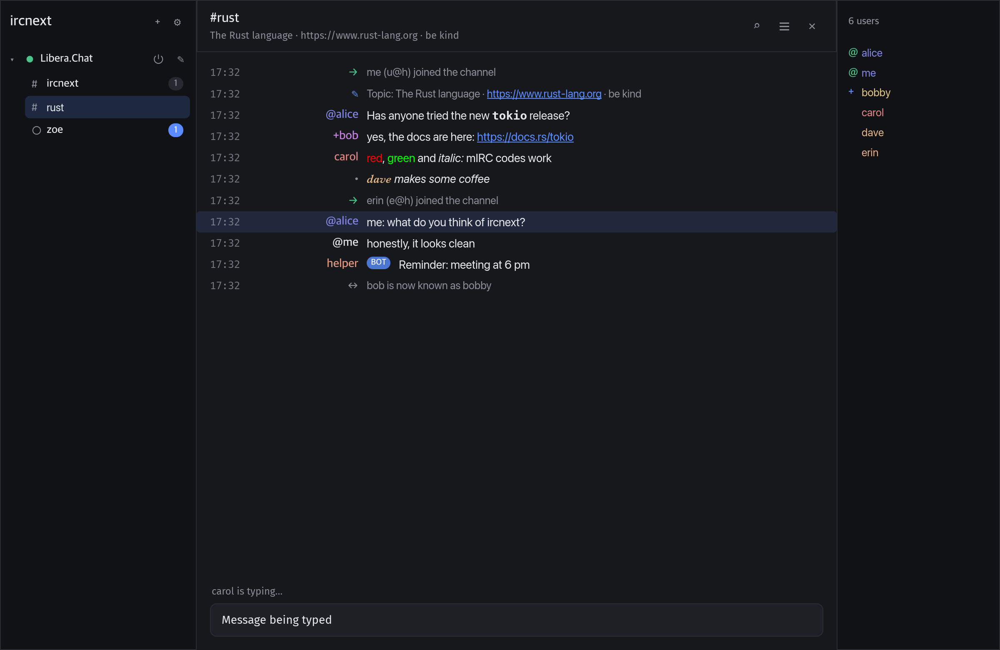

</div>

---

## Contents

- [Why ircnext](#why-ircnext)
- [Features](#features)
- [Screenshots](#screenshots)
- [Installation](#installation)
- [Getting started](#getting-started)
- [Keyboard shortcuts](#keyboard-shortcuts)
- [Commands](#commands)
- [IRCv3](#ircv3)
- [Configuration](#configuration)
- [Security](#security)
- [Architecture](#architecture)
- [Development](#development)
- [Roadmap](#roadmap)
- [Contributing](#contributing)
- [License](#license)

## Why ircnext

- **Native and light**: no embedded browser. The interface is drawn by the GPU with [iced](https://iced.rs), in a single executable of about 14 MB.
- **Familiar**: network → channel tree, member list, aligned colored nicknames, Tab completion… everything that makes HexChat efficient.
- **Modern**: server-side history, typing indicator, synced read markers, message deletion, quick tab switcher, suggestions as you type.
- **Safe by design**: no `unsafe`, no password in clear text on the network, passwords in the system keychain, filtered links, flood protection. See [Security](#security).
- **Fully customizable**: 7 themes, rebindable shortcuts, notifications, privacy, logs… everything is set from the interface, in English or French.

## Features

<table>
<tr><td width="50%" valign="top">

**Chat**
- Several networks at once, automatic reconnection
- TLS by default, SASL PLAIN and EXTERNAL (client certificate, CertFP), STS
- mIRC formatting codes (bold, colors…)
- Clickable links, highlighted mentions
- Private messages, notices, `/me` actions, CTCP
- History loaded when joining (IRCv3 `chathistory`)
- Search in a tab's history
- Logs on disk, ignored users

</td><td width="50%" valign="top">

**Comfort**
- Suggestions as you type: commands, channels, nicknames, NickServ/ChanServ commands and `!…` bot commands
- HexChat-style Tab completion (`nick: `)
- Quick tab switcher (`⌘T` / `Ctrl+T`)
- 37 rebindable shortcuts, adapted to macOS and Windows
- System notifications, Dock bounce, counter in the title
- Commands run after connecting, alternative nicknames

</td></tr>
<tr><td valign="top">

**Appearance**
- 7 themes: Graphite, Midnight, Pure black (OLED), Nordic, Mocha, Light, Sepia, or automatic following the system
- Free accent color
- Text size, monospace font, compact layout
- Adjustable nickname column
- Interface in English or French, following the system by default

</td><td valign="top">

**Privacy**
- Typing indicator and read markers can be turned off
- CTCP replies can be turned off, custom VERSION, TIME in UTC
- NickServ passwords masked everywhere
- Notification content can be hidden

</td></tr>
</table>

## Screenshots

| Light theme | Sepia theme |
|:---:|:---:|
| 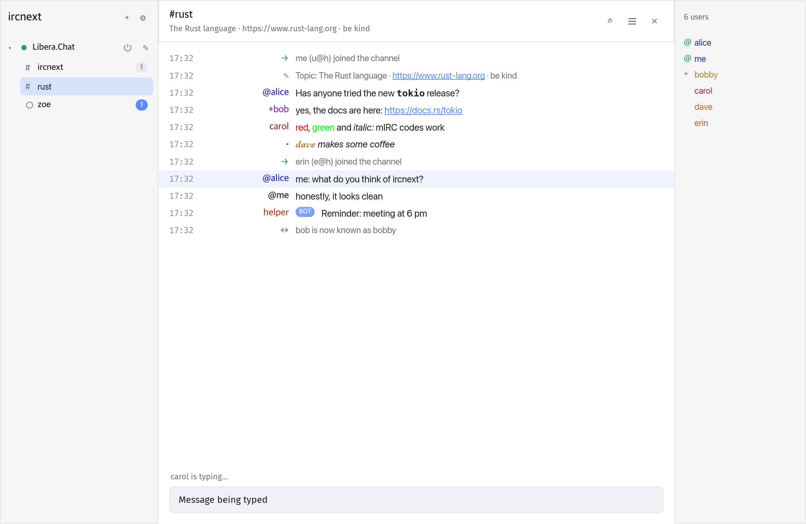 | 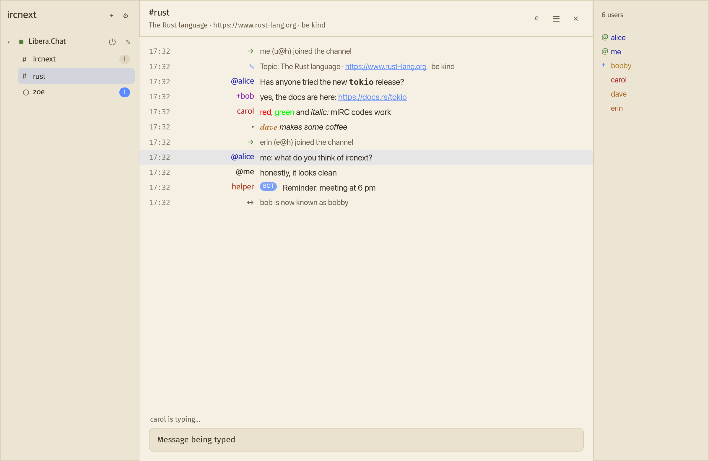 |
| **Suggestions as you type** | **Quick tab switcher** |
| 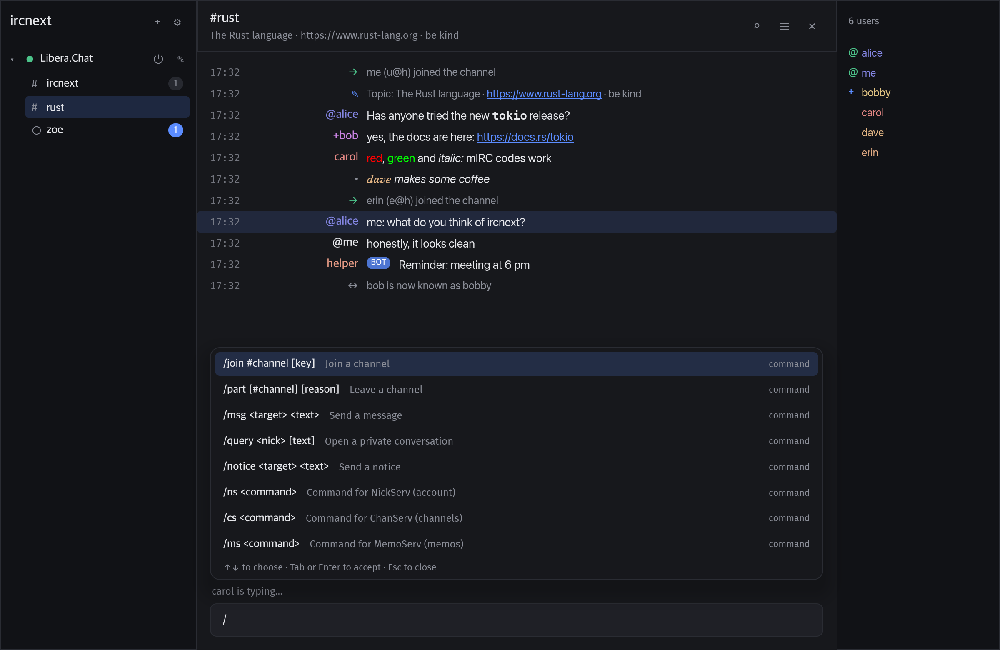 | 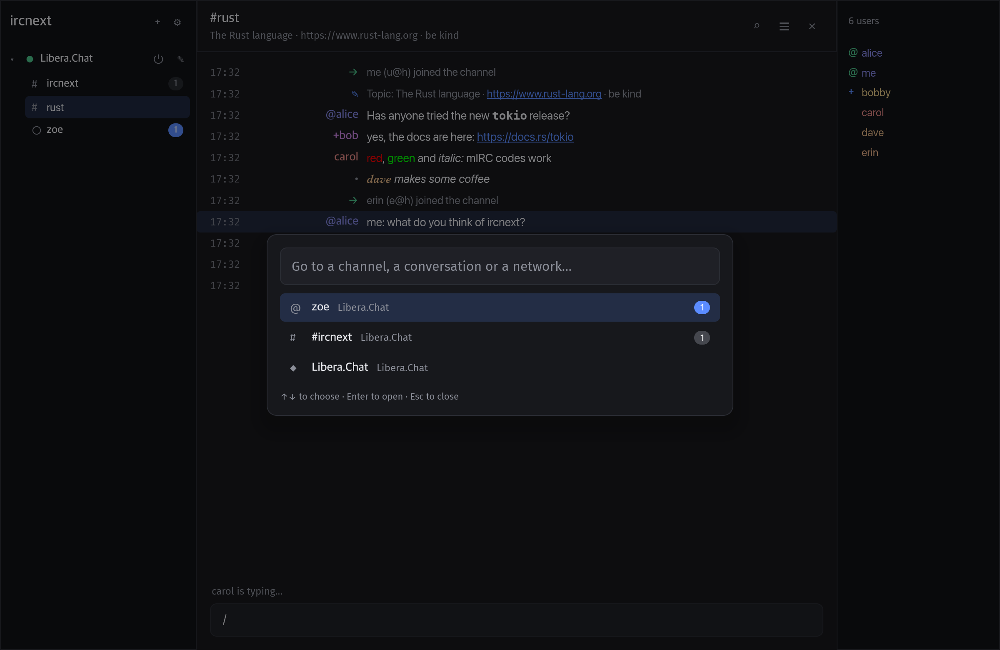 |
| **Settings** | **Configurable shortcuts** |
| 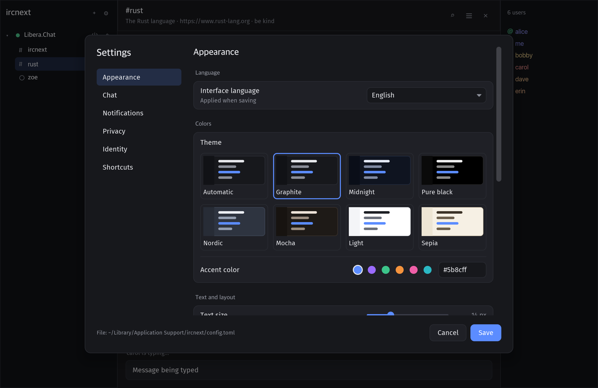 | 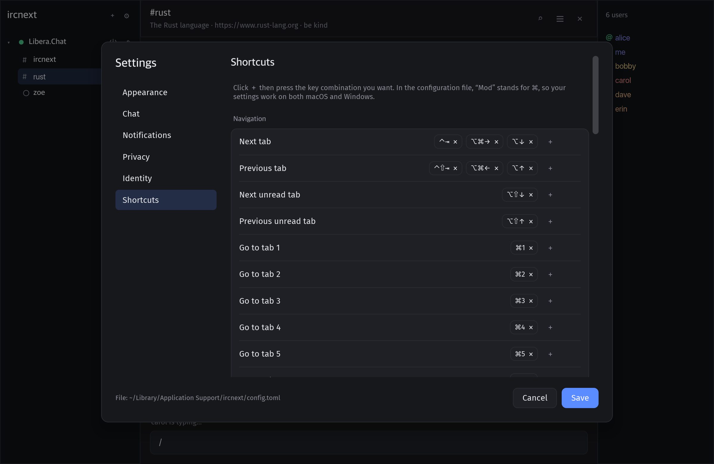 |

<details>
<summary>More screenshots</summary>

| Midnight theme | Nordic theme |
|:---:|:---:|
| 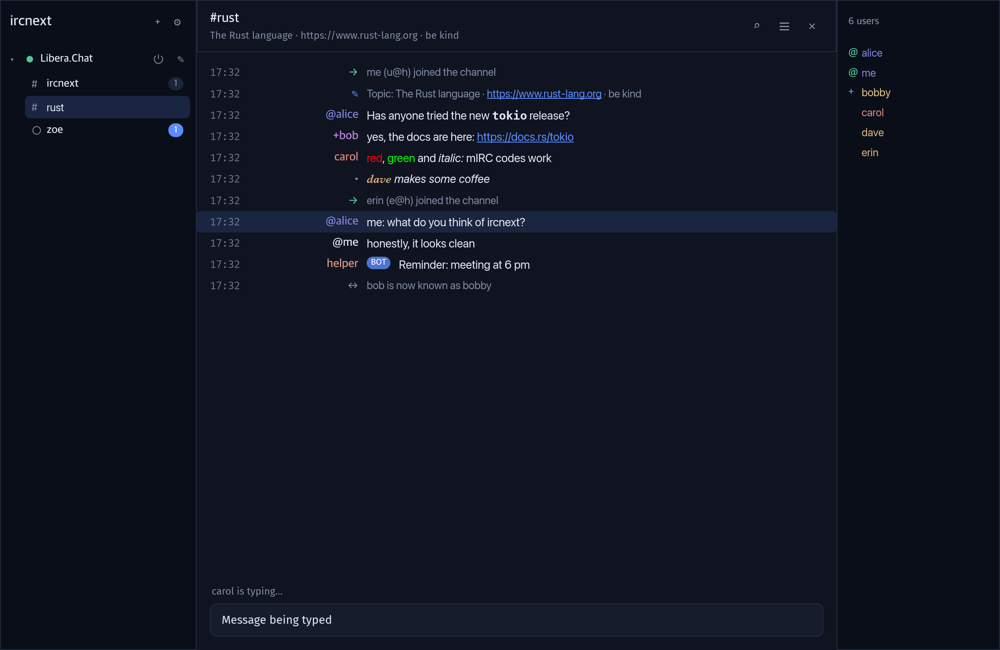 | 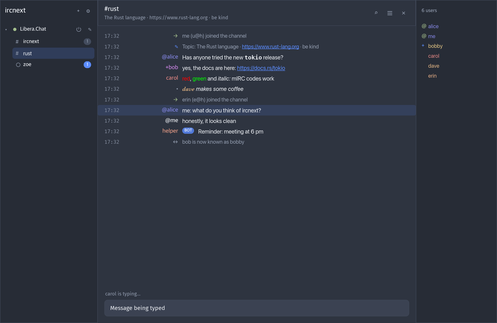 |
| **Search in a tab** | **Adding a network** |
| 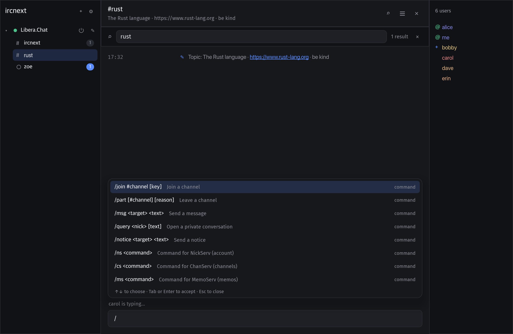 | 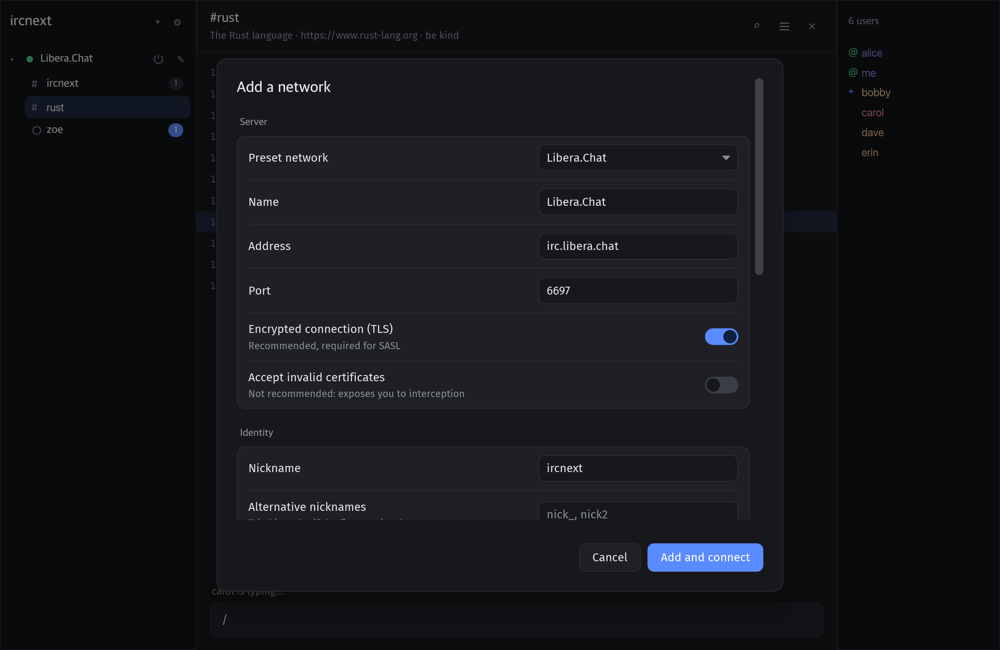 |

</details>

## Installation

### Download

Each version publishes ready-to-use executables on the [releases page](https://github.com/BrystoQ/ircnext/releases/latest):

| System | File |
|---|---|
| macOS 11+ (Apple Silicon and Intel) | `ircnext-X.Y.Z-macos.zip` |
| Windows 10+ (x64) | `ircnext-X.Y.Z-windows-x64.zip` |
| Linux (x64) | `ircnext-X.Y.Z-linux-x64.tar.gz` |

Checksums are in `SHA256SUMS.txt`.

> [!IMPORTANT]
> The executables are not signed with an Apple or Microsoft certificate yet. On first launch:
> - **macOS**: right-click `ircnext.app` then **Open**, or run `xattr -dr com.apple.quarantine ircnext.app`;
> - **Windows**: SmartScreen shows a warning, click **More info** then **Run anyway**.

### Build from source

ircnext builds with [Rust](https://rustup.rs) 1.90 or later.

```sh
git clone https://github.com/BrystoQ/ircnext.git
cd ircnext
cargo build --release
./target/release/ircnext
```

On Windows, the executable is `target\release\ircnext.exe`.

<details>
<summary>System dependencies on Linux</summary>

```sh
# Debian / Ubuntu
sudo apt install build-essential pkg-config libxkbcommon-dev libwayland-dev
```

</details>

> [!NOTE]
> ircnext is developed and tested on macOS; Windows and Linux are supported and built by continuous integration.

## Getting started

1. On first launch, pick a network from the list (Libera.Chat, OFTC, Rizon, EFnet, hackint, IRCnet, QuakeNet, Undernet, Ergo) or enter one.
2. Enter your nickname and, if you have an account, choose an **identification** (password or client certificate).
3. Join a channel with `/join #channel`, or list it in **Channels to join** to find it at every connection.

Type `/` to discover the commands, `@` to mention someone, `#` for a channel. `⌘,` (`Ctrl+,` on Windows and Linux) opens the settings, where **Appearance → Language** switches between English and French.

## Keyboard shortcuts

All shortcuts can be changed in **Settings → Shortcuts**. `Mod` means `⌘` on macOS and `Ctrl` elsewhere, so the same setting works on both systems.

| Action | macOS | Windows / Linux |
|---|---|---|
| Next / previous tab | `⌃⇥` `⌥⌘→` `⌥↓` / `⌃⇧⇥` `⌥⌘←` `⌥↑` | `Ctrl+Tab` `Ctrl+Page↓` `Alt+↓` / `Ctrl+Shift+Tab` `Ctrl+Page↑` `Alt+↑` |
| Next / previous unread tab | `⌥⇧↓` / `⌥⇧↑` | `Alt+Shift+↓` `Alt+A` / `Alt+Shift+↑` |
| Tab 1 to 8, last tab | `⌘1`…`⌘8`, `⌘9` | `Alt+1`…`Alt+8`, `Alt+9` |
| Quick tab switcher | `⌘T` `⌘J` | `Ctrl+T` `Ctrl+J` |
| Search in the tab | `⌘F` | `Ctrl+F` |
| Close tab / mark all as read | `⌘W` / `⇧⎋` | `Ctrl+W` `Ctrl+F4` / `Shift+Esc` |
| Page up / down | `⇞` / `⇟` | `Page↑` / `Page↓` |
| Start / end of history | `⌘↑` `⌘↖` / `⌘↓` `⌘↘` | `Ctrl+Home` / `Ctrl+End` |
| Members / sidebar | `⌘⇧U` / `⌘⇧S` | `Ctrl+Shift+U` / `Ctrl+Shift+S` |
| Clear tab | `⌘L` | `Ctrl+L` |
| Zoom in, out, reset | `⌘=` `⌘-` `⌘0` | `Ctrl+=` `Ctrl+-` `Ctrl+0` |
| Bold, italic, underline, strikethrough | `⌘B` `⌘I` `⌘U` `⌘⇧X` | `Ctrl+B` `Ctrl+I` `Ctrl+U` `Ctrl+Shift+X` |
| Color, reverse, reset formatting | `⌘K` `⌘R` `⌘O` | `Ctrl+K` `Ctrl+R` `Ctrl+O` |
| Add a network / settings / quit | `⌘N` / `⌘,` / `⌘Q` | `Ctrl+N` / `Ctrl+,` `Ctrl+P` / `Ctrl+Q` |

Fixed keys: `Tab` completes, `↑` / `↓` browse the input history or the suggestions, `Enter` sends, `Esc` closes.

## Commands

`/help` shows the full list in the application.

| Command | Purpose |
|---|---|
| `/join #channel [key]`, `/part [#channel] [reason]` | Join or leave a channel |
| `/msg <target> <text>`, `/query <nick>`, `/notice` | Messages and private conversations |
| `/me <action>` | Describe an action |
| `/nick`, `/away [message]`, `/back` | Nickname and away status |
| `/topic [topic]`, `/whois <nick>`, `/invite` | Channel and users |
| `/kick`, `/ban`, `/unban`, `/op`, `/deop`, `/voice`, `/devoice`, `/mode` | Moderation |
| `/ns`, `/cs`, `/ms`, `/hs` | NickServ, ChanServ, MemoServ, HostServ |
| `/ignore [mask]`, `/unignore <mask>` | Ignored users |
| `/ctcp`, `/quote <line>` | CTCP and raw command |
| `/connect`, `/quit [reason]`, `/close`, `/clear` | Connection and tabs |

NickServ, ChanServ, MemoServ and HostServ commands are suggested with their syntax as soon as you type `/ns `. Bot commands (`!weather`, `!help`…) seen in a channel are offered as soon as you type `!`.

## IRCv3

ircnext automatically negotiates the [IRCv3](https://ircv3.net) extensions offered by the server.

| Area | Extensions |
|---|---|
| Connection | `cap-notify`, `sasl` (PLAIN, EXTERNAL), `sts` |
| Messages | `message-tags`, `server-time`, `echo-message`, `batch`, `labeled-response`, `msgid` (deduplication), `standard-replies`, `UTF8ONLY` |
| History | `draft/chathistory`, `draft/event-playback`, `draft/read-marker`, `draft/message-redaction` |
| Users | `account-notify`, `account-tag`, `away-notify`, `extended-join`, `chghost`, `setname`, `multi-prefix`, `userhost-in-names`, `invite-notify` |
| Presence | `MONITOR`, `extended-monitor`, `WHOX`, `BOT` |
| Channels | `draft/channel-rename` |
| Client tags | `+typing`, the [`+draft/autocomplete`](https://github.com/ircv3/ircv3-specifications/pull/415) draft (completion offered by bots) |

## Configuration

Everything is set from the interface. Settings are saved in a TOML file:

| System | Location |
|---|---|
| macOS | `~/Library/Application Support/ircnext/config.toml` |
| Windows | `%APPDATA%\ircnext\config\config.toml` |
| Linux | `~/.config/ircnext/config.toml` |

The `IRCNEXT_CONFIG` environment variable points to another file. Logs go to a `logs/` folder and generated client certificates to a `certs/` folder, both next to the configuration.

## Security

- **No password in clear text**: SASL is refused without TLS, except towards a local server (bouncer).
- **Passwords in the system keychain** (macOS Keychain, Windows Credential Manager, Secret Service), never in the configuration file.
- **Client certificates**: SASL EXTERNAL and CertFP, with self-signed certificates created by the application (`0600`).
- **STS** is only remembered after a TLS connection with a verified certificate.
- **Private files**: configuration and logs in `0600`, folders in `0700`, atomic writes.
- **NickServ passwords masked** on display, in logs and in the input history.
- **Filtered links**: only `http` and `https` open; bidirectional control characters are removed, so a link cannot be disguised.
- **Flood protection**: limited sending (5 messages, then 1 every 2 s), limited CTCP replies.
- **Robustness**: bounded memory against a hostile server, no command injection, `unsafe` forbidden in all the code.

To report a vulnerability, see [SECURITY.md](SECURITY.md).

## Architecture

A Cargo workspace of three crates, from the protocol to the interface:

```
crates/
├── proto/    ircnext-proto   Pure IRC protocol, no I/O: messages, IRCv3 tags,
│                             mIRC formatting, ISUPPORT, casemapping
├── client/   ircnext-client  TCP/TLS connection (rustls), CAP/SASL/STS registration,
│                             network state, reconnection, rate limiting
└── app/      ircnext         iced interface (Elm architecture): tabs, settings,
                              shortcuts, notifications, logs, translations
```

The protocol logic is written without input/output and tested on its own; only a few functions touch the network. Interface texts are written in English and translated through [`crates/app/locales/fr.toml`](crates/app/locales/fr.toml).

## Development

```sh
cargo test --workspace                          # ~190 tests
cargo clippy --workspace --all-targets          # clippy::pedantic, zero warnings
cargo test -p ircnext -- --ignored snapshots    # screenshots in target/snapshots/{en,fr}/
```

The screenshots in this README are rendered headlessly by the `snapshots` test, then copied to `docs/screenshots/`.

## Roadmap

- [x] Ready-to-use binaries (macOS, Windows, Linux)
- [x] Passwords in the system keychain
- [x] Certificate authentication (SASL EXTERNAL)
- [x] English interface, French translation
- [ ] SOCKS5 proxy
- [ ] DCC transfers
- [ ] `draft/multiline`

## Contributing

Contributions are welcome! Read [CONTRIBUTING.md](CONTRIBUTING.md) before opening a pull request.

## License

Distributed under the [MIT](LICENSE) license. © 2026 BrystoQ.
